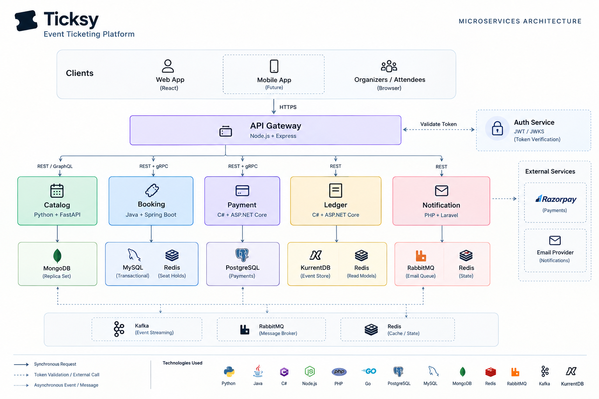

# Ticksy — Event Ticketing Platform

Ticksy is a microservices-based event ticketing platform designed around event discovery, organizer publishing, seat inventory, booking, payments, financial ledgers and notifications. It uses a React frontend, an API Gateway, and independently deployable backend services implemented in multiple languages.

> **Repository guide:** This README describes the code and deployment files in this repository snapshot. Some architecture documents describe integrations or future infrastructure that are not fully wired into this version. See [Implementation notes and known gaps](#implementation-notes-and-known-gaps) before treating the whole system as a production-ready end-to-end deployment.

## Contents

- [What Ticksy does](#what-ticksy-does)
- [Architecture at a glance](#architecture-at-a-glance)
- [Microservices and technologies](#microservices-and-technologies)
- [Protocols and communication](#protocols-and-communication)
- [Databases and infrastructure](#databases-and-infrastructure)
- [Typical request flows](#typical-request-flows)
- [Repository layout](#repository-layout)
- [Run locally with Docker Compose](#run-locally-with-docker-compose)
- [Use the application](#use-the-application)
- [Useful endpoints and ports](#useful-endpoints-and-ports)
- [Development and testing](#development-and-testing)
- [Kubernetes deployment](#kubernetes-deployment)
- [Security notes](#security-notes)
- [Implementation notes and known gaps](#implementation-notes-and-known-gaps)
- [Troubleshooting](#troubleshooting)

## What Ticksy does

The product and service boundaries cover the main workflows of an event ticketing system:

1. **Accounts and access:** register and log in as an attendee or organizer; issue access tokens and refresh sessions; authorize operations by role.
2. **Event catalog:** create and manage event metadata, venues, categories, and ticket tiers; publish or cancel events; browse and search published events.
3. **Seat inventory and booking:** retrieve seat maps, hold seats for a limited period, and manage booking lifecycle state. The Booking service is designed to prevent two users from successfully holding the same seat.
4. **Payment processing:** create payment records and provider orders, verify payment state, process Razorpay webhooks, and support administrative refunds.
5. **Financial ledger:** record financial events in an append-only event store and expose organizer balance/ledger views through Redis-backed read models.
6. **Notifications:** route business events into email-delivery jobs, track notification state and preferences, and support retry/suppression administration.
7. **Centralized access:** route browser/API traffic through the Gateway, which provides JWT checks, role checks, rate limiting, request IDs, proxy timeouts, and upstream circuit breakers.

The frontend provides a branded event-ticketing experience with event discovery, authentication dialogs, event details, seat selection, checkout, ticket views, organizer tools, and ledger/notification-related UI sections. Some screens contain demo-oriented or mock data, so confirm backend connectivity before assuming every UI interaction completes a real transaction.

## Architecture at a glance



### Main design principles

- **Database per service:** each service owns its own persistence and domain model instead of sharing tables.
- **Polyglot microservices:** each service uses a runtime and storage model suited to its responsibilities.
- **Synchronous APIs where a response is needed:** HTTP/REST is used for client-facing operations; gRPC is used for typed internal contracts.
- **Asynchronous processing where appropriate:** Kafka/RabbitMQ-related code supports event-driven notifications and retryable delivery.
- **Defense in depth:** the Gateway performs edge checks, while services validate JWTs and enforce domain-level authorization.
- **Consistency where it matters:** Booking uses MySQL transactions as the authoritative seat state; Redis is a fast hold coordination layer, not the durable source of truth.
- **Resilience and observability:** request IDs, structured logs, health endpoints, circuit breakers, timeouts, metrics, and Kubernetes manifests are included in various services.

## Microservices and technologies

### 1. Frontend

| Area | Details |
|---|---|
| Purpose | User interface for attendees, organizers, and administrators |
| Stack | React 19, TypeScript, Vite, Tailwind CSS v4, Lucide icons |
| HTTP entry point | API Gateway at `http://localhost:8080` |
| Container | Nginx serves the production build |
| Host ports | `3000` and `5173` are both mapped to container port `80` in Compose |
| Data storage | No backend database; the UI calls APIs and also includes demo/mock data |

The frontend contains authentication, event details, seat-map, checkout, ticket, organizer-dashboard, and architecture-related components. For development, run Vite from `frontend/`; for the containerized build, Compose serves the compiled assets through Nginx.

### 2. API Gateway

| Area | Details |
|---|---|
| Purpose | Single public HTTP entry point; routes requests to internal services |
| Stack | Node.js 22, TypeScript, Express 5 |
| Port | `8080` |
| Protocol | HTTP reverse proxy; forwards REST and GraphQL HTTP traffic |
| Key libraries/patterns | `undici`, `jose`, `opossum`, `express-rate-limit`, Helmet, Pino |
| Database | None |

Responsibilities include route matching, JWT verification against Auth's JWKS endpoint, coarse role-based authorization, CORS, rate limiting, request ID propagation, upstream timeouts, and per-upstream circuit breakers. It forwards requests to Auth, Catalog, Booking, Payment, Ledger, and Notification.

Useful endpoints include `/health/live`, `/health/ready`, and `/health/upstreams`.

### 3. Auth Service

| Area | Details |
|---|---|
| Purpose | Registration, login, refresh-session rotation, logout, user identity and roles |
| Stack | Node.js 22, TypeScript, Express 5 |
| ORM/migrations | Prisma |
| Database | PostgreSQL 16 |
| Port | `4001` |
| Protocols | REST/HTTP; JWT/JWKS for token verification |
| Security | RS256 access tokens, public JWKS endpoint, hashed opaque refresh tokens, rate limiting |

The Auth service signs access tokens with an RSA private key and exposes public verification keys at `/.well-known/jwks.json`. Other services validate the token signature and claims without needing the private signing key.

Principal routes include:
- `POST /api/v1/auth/register`
- `POST /api/v1/auth/login`
- `POST /api/v1/auth/refresh`
- `POST /api/v1/auth/logout`
- `GET /api/v1/auth/me`
- `GET /.well-known/jwks.json`

The default configured issuer and audience are `ticksy-auth` and `ticksy-api`; all services that validate tokens must agree on these values.

### 4. Catalog Service

| Area | Details |
|---|---|
| Purpose | Owns event metadata, venues, categories, ticket tiers, and publishing status |
| Stack | Python 3.12, FastAPI, Pydantic v2 |
| Database/driver | MongoDB 8, native PyMongo Async API |
| HTTP port | `4002` |
| Internal RPC port | `50052` |
| Protocols | REST/HTTP, read-only GraphQL, gRPC with Protocol Buffers |
| Authentication | RS256 JWT validation through Auth's JWKS endpoint |

Catalog owns event descriptions and ticket-tier metadata, but **does not own live seat availability or bookings**. A single-node MongoDB replica set (`rs0`) is configured so MongoDB change streams can be used. MongoDB documents are a natural fit for event records containing nested venue and ticket-tier data.

REST endpoints are under `/api/v1/catalog`, including event listing, event details, organizer event management, and category lookup. GraphQL is exposed at `/graphql`. Booking calls Catalog's `GetEventForBooking` gRPC method to fetch the event and ticket-tier information needed to initialize inventory.

Important design choices:
- MongoDB stores flexible, nested event data.
- Indexes support slug uniqueness, search, status/date filtering, organizer queries, and optional geo queries.
- REST is convenient for ordinary client operations; GraphQL is useful for nested read queries; gRPC provides a strongly typed service-to-service contract.
- The shared contract is `shared/proto/catalog/v1/catalog.proto`.

### 5. Booking Service

| Area | Details |
|---|---|
| Purpose | Seat inventory, temporary holds, bookings, expiry, and booking state transitions |
| Stack | Java 21, Spring Boot 3, Spring Data JPA |
| Schema migrations | Flyway |
| Primary database | MySQL 8 / InnoDB |
| Fast hold coordination | Redis 7 |
| Port | `4003` |
| Protocols | REST/HTTP for client operations; gRPC client to Catalog |
| Security/resilience | Spring Security OAuth2 Resource Server, RS256/JWKS, Resilience4j, Micrometer |

Booking owns seats and booking lifecycle state. Its MySQL schema includes event inventory, seats, bookings, booking items, outbox events, and processed events.

Seat-hold design:
- MySQL is the durable source of truth.
- Conditional updates and database transactions prevent two requests from successfully claiming the same seat.
- Requested seat labels are sorted before acquiring locks to reduce deadlock risk.
- Redis `SET ... NX PX` is used as a fast contention filter, with compare-and-delete behavior so one booking cannot release another booking's Redis key.
- Holds expire; a scheduled task cleans up expired booking/seat state.
- The configured `HOLD_TTL_SECONDS=600` means **10 minutes**. Check the UI copy before relying on displayed countdown text.
- The configured maximum is six seats per booking.

Booking calls Catalog over gRPC using `CATALOG_GRPC_TARGET` (normally `catalog-service:50052` inside Docker or `localhost:50052` when run natively). A circuit breaker, timeout, and retry policy protect this dependency. The database includes an outbox table to support reliable event publication.

### 6. Payment Service

| Area | Details |
|---|---|
| Purpose | Payment records, provider order creation, verification, webhooks, refunds |
| Stack | C# / ASP.NET Core on .NET 10 |
| ORM/migrations | Entity Framework Core |
| Database | PostgreSQL 16 |
| HTTP port | `4004` |
| gRPC port | `50054` |
| External provider | Razorpay |
| Reliability | Idempotency constraints, optimistic concurrency, transactional outbox, background outbox worker |

The service creates Razorpay orders, tracks payment states, verifies checkout results, validates Razorpay webhook signatures, and exposes admin refund operations. The REST webhook route is `POST /api/v1/payments/webhooks/razorpay`. Authenticated routes include payment lookup, verification, and admin refund.

The service implements the shared payment gRPC contract in `shared/proto/payment/v1/payment.proto`. Keep Razorpay credentials in environment variables and use test-mode credentials for local development.

### 7. Ledger Service

| Area | Details |
|---|---|
| Purpose | Organizer balances, platform fees, ledger statements, payouts, admin financial controls |
| Stack | C# / ASP.NET Core (see `services/ledger/src/Ticksy.Ledger.Api/Ticksy.Ledger.Api.csproj` for the target framework) |
| Event store | KurrentDB / EventStore-compatible database |
| Read model/checkpoints | Redis 7 |
| Port | `4005` |
| Protocol | REST/HTTP |
| Security/observability | JWT/JWKS, role authorization, Serilog JSON logs, Prometheus metrics |

Ledger uses an event-sourced write model: financial commands produce append-only events in KurrentDB. A background projection updates Redis read models so balance and statement queries do not have to rebuild the full event stream on every request. This is a CQRS-style separation between write-side events and read-side projections.

The default platform fee is configured as `500` basis points (5%). Payout limits and other financial settings are environment-configurable. Development-only event-injection endpoints should not be exposed in production.

### 8. Notification Service

| Area | Details |
|---|---|
| Purpose | Notification records, user preferences, email delivery, retries, suppressions, delivery webhooks |
| Stack | PHP 8.3+, Laravel 11 in `composer.json` |
| Durable notification state/cache | Redis 7; the service intentionally has no SQL database |
| Job broker | RabbitMQ 3 with management UI |
| Event input | Kafka consumer using `ext-rdkafka` |
| Email provider | Resend API, with a log-only driver for development |
| Port | `4006` |
| Protocols | REST/HTTP, Kafka consumer, AMQP/RabbitMQ, Redis |

The intended flow is: consume a domain event from Kafka, validate/deduplicate it, create notification state in Redis, publish a delivery job to RabbitMQ, then have a worker send email through Resend or log the message in development. Retry queues and a dead-letter queue support failed delivery handling.

Useful routes include `/api/v1/notifications/me`, `/api/v1/notifications/me/preferences`, admin notification routes, and `POST /api/v1/notifications/webhooks/resend`.

Caveat: Kafka consumption requires an external/local Kafka broker or additional Compose configuration.

## Protocols and communication

| Protocol/technology | Where it is used | Why |
|---|---|---|
| REST over HTTP | Frontend/Gateway and service APIs | Familiar, easy to test, suitable for browser-facing CRUD and commands |
| GraphQL over HTTP | Catalog `/graphql` | Fetch event, venue, and ticket-tier fields in one nested query |
| gRPC over HTTP/2 | Booking → Catalog; Payment exposes gRPC | Typed contracts and efficient internal service communication |
| Protocol Buffers | `shared/proto/catalog/v1/catalog.proto`, `shared/proto/payment/v1/payment.proto` | Versioned request/response definitions shared across languages |
| JWT (RS256) + JWKS | Auth issues tokens; other services validate them | Public-key validation without distributing the signing private key |
| Redis | Booking holds; Ledger projections; Notification state/cache | Low-latency ephemeral coordination and read models |
| RabbitMQ / AMQP | Notification delivery jobs and retry queues | Durable work queues, acknowledgements, retries, dead-lettering |
| Kafka | Notification event ingestion and planned domain-event integration | Decouples event producers from asynchronous consumers |
| Transactional outbox | Booking and Payment database models | Saves state changes and outgoing event records in one DB transaction; CDC/publishing still needs to be wired and operated |
| KurrentDB event streams | Ledger | Append-only financial events and replayable projections |

## Databases and infrastructure

| Component | Storage/technology | Owner and purpose | Compose host port |
|---|---|---|---:|
| Auth DB | PostgreSQL 16 | Accounts, credentials/session records and auth data | `5433` |
| Catalog DB | MongoDB 8 replica set `rs0` | Events, venues and ticket tiers | `27017` |
| Booking DB | MySQL 8 / InnoDB | Inventory, seats, bookings and outbox records | `3307` |
| Booking Redis | Redis 7 | Temporary seat-hold coordination | `6380` |
| Payment DB | PostgreSQL 16 | Payments, refunds, webhook deduplication and outbox | `5434` |
| Ledger event store | KurrentDB | Append-only financial events | `2113` |
| Ledger Redis | Redis 7 | Ledger read models and projection checkpoints | `6381` |
| Notification Redis | Redis 7 | Notification records, preferences and delivery state | `6382` |
| Notification broker | RabbitMQ 3 Management | Email delivery queue, retries and dead-letter queue | `5672`, UI `15672` |

The host ports are deliberately different for services that use the same database technology so they can coexist with locally installed database instances. Within Docker, containers should connect using Compose service names and **container ports**, not the host-mapped ports.

## Typical request flows

### A. Sign in

1. The browser sends login details to `POST /api/v1/auth/login` through the Gateway.
2. Auth verifies the credentials and issues an RS256 access token plus refresh-session cookie.
3. The Gateway and protected backend services validate the access token using the Auth JWKS public key.
4. Role and ownership checks restrict organizer/admin operations.

### B. Publish and discover an event

1. An authenticated Organizer creates event metadata in Catalog.
2. Catalog validates the event and ticket tiers, then stores the document in MongoDB.
3. The organizer publishes the event when its validation rules are satisfied.
4. Public clients browse published events through REST or read them through GraphQL.

### C. View seats and hold them

1. Booking receives a seat-map or hold request.
2. If inventory has not yet been initialized, Booking requests the event/tier data from Catalog over gRPC.
3. Booking creates inventory and seat records in MySQL.
4. Redis helps reject conflicting hold attempts quickly; MySQL transactions decide the final durable seat state.
5. Expired holds are released by the expiry process.

### D. Payment and ledger

1. Payment can create a provider order and later update payment state based on verification/webhooks.
2. Payment writes an outbox event in the same database transaction as a payment state transition.
3. Ledger can consume financial domain events and append them to KurrentDB, then update Redis projections.

The source tree contains the Payment and Ledger components and their contracts. However, inspect the current service wiring before assuming all booking → payment → ledger transitions are connected automatically in this repository snapshot.

### E. Notifications

1. A domain event is consumed from Kafka.
2. Notification validates freshness and idempotency, then stores notification state in Redis.
3. It publishes an email job to RabbitMQ.
4. A worker sends the email via Resend or logs it locally.
5. Provider webhooks update delivery/suppression state.


## Repository layout

```text
Ticksy-main/
├── frontend/                 # React + TypeScript + Vite UI
├── services/
│   ├── auth/                  # Node.js + Express + Prisma + PostgreSQL
│   ├── gateway/               # Node.js + Express reverse proxy
│   ├── catalog/               # FastAPI + MongoDB + GraphQL + gRPC
│   ├── booking/               # Spring Boot + MySQL + Redis
│   ├── payment/               # ASP.NET Core + PostgreSQL + Razorpay
│   ├── ledger/                # ASP.NET Core + KurrentDB + Redis
│   └── notification/          # Laravel + Redis + RabbitMQ + Kafka consumer
├── shared/proto/              # Shared gRPC Protocol Buffer contracts
├── infra/
│   ├── docker-compose.yml     # Multi-container local stack
│   └── k8s/                   # Kubernetes/Kustomize manifests
├── docs/                      # Architecture, service specs, demo/evaluation notes
├── .agents/AGENTS.md          # Repository-specific contribution rules
└── README.md                  # This guide
```

## Run locally with Docker Compose

### Prerequisites

Install:
- Docker Desktop with Docker Compose v2
- Git
- A browser

Optional for native development: Node.js 22+, Python 3.12, Java 21 + Maven, .NET SDK compatible with the service project, PHP 8.3 + Composer, and OpenSSL.

### Step 1: Extract and enter the repository

```powershell
cd D:\projects\MAP
Expand-Archive -Path .\Ticksy-main.zip -DestinationPath . -Force
cd .\Ticksy-main
```

Use the actual extracted folder path if it differs. If the project is already cloned, enter that repository instead of extracting another copy.

### Step 2: Create local environment files

The repository intentionally does not include service `.env` files or private keys. From the repository root in PowerShell:

```powershell
Copy-Item services\auth\.env.example services\auth\.env
Copy-Item services\gateway\.env.example services\gateway\.env
Copy-Item services\catalog\.env.example services\catalog\.env
Copy-Item services\booking\.env.example services\booking\.env
Copy-Item services\payment\.env.example services\payment\.env
Copy-Item services\ledger\.env.example services\ledger\.env
Copy-Item services\notification\.env.example services\notification\.env
```

Review the generated files and change any placeholder credentials. Do not commit `.env` files or real secrets.

### Step 3: Generate the Auth RSA key pair

The Auth service signs tokens using RS256. With OpenSSL installed, run from the repository root:

```powershell
New-Item -ItemType Directory -Force services\auth\keys
openssl genrsa -out services\auth\keys\private.pem 2048
openssl rsa -in services\auth\keys\private.pem -pubout -out services\auth\keys\public.pem
```

Keep `private.pem` private and out of version control. The public key is published through the Auth JWKS endpoint.

### Step 4: Configure the root Compose environment

The Compose file references `${PAYMENT_DB_PASSWORD}`. Create a root `.env` file with a development-only value that matches `services/payment/.env`:

```powershell
@'
PAYMENT_DB_PASSWORD=replace_with_a_local_dev_password
'@ | Set-Content .env
```

Then set the same password in `services/payment/.env` for `PAYMENT_DB_PASSWORD` and `PAYMENT_DB_CONNECTION`. Do not use these example credentials in production.

The Auth, Gateway, Catalog, Booking, Payment, Ledger, and Notification services each load their own `.env` file. Compose also overrides several service-to-service URLs with Docker DNS names.

### Step 5: Start the stack

From the repository root:

```powershell
docker compose -f infra/docker-compose.yml config
docker compose -f infra/docker-compose.yml up --build -d
```

The first command validates Compose interpolation and configuration. If it reports missing variables or environment files, fix those before starting the stack.

Check container status:

```powershell
docker compose -f infra/docker-compose.yml ps
```

Follow logs:

```powershell
docker compose -f infra/docker-compose.yml logs -f gateway auth-service catalog-service booking-service
```

For a specific service:

```powershell
docker logs -f catalog-service
```

### Step 6: Open the application

- Frontend: `http://localhost:3000`
- API Gateway: `http://localhost:8080`
- Auth direct: `http://localhost:4001`
- Catalog direct: `http://localhost:4002`
- Booking direct: `http://localhost:4003`
- Payment direct: `http://localhost:4004`
- Ledger direct: `http://localhost:4005`
- Notification direct: `http://localhost:4006`

Use the Gateway (`http://localhost:8080`) for normal API requests, because it applies the configured routing and edge security rules.

### Step 7: Check health

Try these in a browser or PowerShell:

```powershell
Invoke-RestMethod http://localhost:8080/health/live
Invoke-RestMethod http://localhost:4001/health/live
Invoke-RestMethod http://localhost:4002/health/live
Invoke-RestMethod http://localhost:4003/health/live
Invoke-RestMethod http://localhost:4004/health/live
Invoke-RestMethod http://localhost:4005/health/live
Invoke-RestMethod http://localhost:4006/health/live
```

Service readiness checks may depend on databases and other upstreams. A live check only means the process is running; it does not prove that all workflows are integrated.

### Stop the stack

```powershell
docker compose -f infra/docker-compose.yml down
```

To also delete persisted local database volumes (this deletes local data):

```powershell
docker compose -f infra/docker-compose.yml down -v
```

## Use the application

1. Open `http://localhost:3000`.
2. Register an attendee or organizer using the authentication UI, or call Auth's register endpoint.
3. Sign in and use the resulting session/access token for protected operations.
4. Browse published events through the UI or `GET /api/v1/catalog/events`.
5. Organizer/admin accounts can create and manage catalog events, subject to service authorization.
6. Open an event and test seat-map/inventory endpoints. Booking initializes inventory using Catalog's gRPC contract where needed.
7. Configure Razorpay test credentials before expecting live provider order creation or webhook verification. With placeholder credentials, payment operations will not complete against Razorpay.
8. Notification email delivery defaults to `EMAIL_DRIVER=log` in the example environment. To send real email, configure Resend credentials and webhooks intentionally.
9. Ledger development endpoints can be used to demonstrate event-sourced projections, but must remain restricted to development.

For API-level debugging, use the Gateway routes documented in `services/gateway/README.md` and each service's own README. Check `services/catalog/README.md`, `services/booking/README.md`, and `docs/EVALUATION_DEMO_GUIDE.md` for focused workflows and architecture demos.

## Useful endpoints and ports

### Main application and service ports

| Component | Host URL/port | Notes |
|---|---|---|
| Frontend | `http://localhost:3000` | Nginx-served UI in Compose |
| Gateway | `http://localhost:8080` | Recommended API entry point |
| Auth | `http://localhost:4001` | REST and JWKS |
| Catalog REST/GraphQL | `http://localhost:4002` | `/api/v1/catalog/...`, `/graphql` |
| Catalog gRPC | `localhost:50052` | Internal RPC; gRPC client required |
| Booking | `http://localhost:4003` | REST |
| Payment REST | `http://localhost:4004` | REST/webhooks |
| Payment gRPC | `localhost:50054` | Internal RPC |
| Ledger | `http://localhost:4005` | REST and `/metrics` |
| Notification | `http://localhost:4006` | REST and webhooks |
| RabbitMQ management | `http://localhost:15672` | Development credentials are `guest` / `guest` unless changed |
| MongoDB | `localhost:27017` | Replica set `rs0` |
| Auth PostgreSQL | `localhost:5433` | Compose host mapping |
| Booking MySQL | `localhost:3307` | Compose host mapping |
| Booking Redis | `localhost:6380` | Compose host mapping |
| Payment PostgreSQL | `localhost:5434` | Compose host mapping |
| KurrentDB | `localhost:2113` | Ledger event store |
| Ledger Redis | `localhost:6381` | Compose host mapping |
| Notification Redis | `localhost:6382` | Compose host mapping |
| RabbitMQ AMQP | `localhost:5672` | Notification job broker |

### API route prefixes

| Prefix/endpoint | Service | Purpose |
|---|---|---|
| `/api/v1/auth/*` | Auth | Register, login, refresh, logout, profile |
| `/.well-known/jwks.json` | Auth | Public signing-key set |
| `/api/v1/catalog/*` | Catalog | Event and category operations |
| `/graphql` | Catalog | Read-only GraphQL queries |
| `/api/v1/bookings/*` | Booking | Inventory, seat maps, holds, bookings |
| `/api/v1/payments/*` | Payment | Payment lookup, verification, refunds |
| `/api/v1/payments/webhooks/razorpay` | Payment | Provider webhook |
| `/api/v1/ledger/*` | Ledger | Organizer/admin financial views and operations |
| `/api/v1/notifications/*` | Notification | User preferences/history, admin tools, provider webhook |

## Development and testing

### Frontend

```powershell
cd frontend
npm ci
npm run dev
```

Vite normally serves the development UI on `http://localhost:5173`. Confirm `frontend/src/services/api.ts` and Vite configuration point API requests at the local Gateway.

```powershell
npm run lint
npm run build
```

### Auth or Gateway

```powershell
cd services\auth
npm ci
npm run dev
```

For Gateway, use `cd services\gateway`, `npm ci`, and `npm run dev`. These services require their own `.env` files and their upstream services for full integration.

### Catalog

From the repository root, use Python 3.12:

```powershell
py -3.12 -m venv services\catalog\.venv
.\services\catalog\.venv\Scripts\Activate.ps1
python -m pip install --upgrade pip
python -m pip install -e "services/catalog[test]"
```

Generate Python gRPC stubs from the shared contract:

```powershell
New-Item -ItemType Directory -Force services\catalog\app\grpc_server\generated
python -m grpc_tools.protoc -I shared/proto --python_out=services/catalog/app/grpc_server/generated --grpc_python_out=services/catalog/app/grpc_server/generated shared/proto/catalog/v1/catalog.proto
New-Item -ItemType File -Force services\catalog\app\grpc_server\generated\__init__.py
(Get-Content services\catalog\app\grpc_server\generated\catalog_pb2_grpc.py) -replace '^import catalog_pb2 as catalog__pb2', 'from . import catalog_pb2 as catalog__pb2' | Set-Content services\catalog\app\grpc_server\generated\catalog_pb2_grpc.py
```

Start Catalog only after MongoDB replica set and Auth are reachable:

```powershell
Copy-Item services\catalog\.env.example services\catalog\.env -ErrorAction SilentlyContinue
$env:PYTHONPATH = (Resolve-Path services\catalog).Path
python -m uvicorn app.main:app --app-dir services/catalog --reload --port 4002
```

Run tests:

```powershell
python -m pytest services/catalog/tests
```

### Booking

Requires Java 21, Maven, MySQL, Redis, Auth, and Catalog gRPC:

```powershell
cd services\booking
mvn test
mvn spring-boot:run
```

The concurrency test is especially relevant to the seat-hold correctness claim. For integration tests, inspect `services/booking/README.md` and the Testcontainers configuration.

### Payment and Ledger

Use the relevant .NET SDK for each `.csproj` target framework:

```powershell
cd services\payment
dotnet test
```

```powershell
cd services\ledger
dotnet test
```

Payment integration tests need database/provider configuration. Ledger integration tests need KurrentDB and Redis.

### Notification

Requires PHP 8.3+, Composer, Redis, RabbitMQ, and Kafka for event consumption. The `.env.example` defaults to a log email driver, so it can be exercised without sending real email once dependencies are available. See `services/notification/README.md` for worker commands, queue topology, Kafka topics, and Resend setup.

## Kubernetes deployment

The repository includes Kubernetes manifests under `infra/k8s/`, organized with Kustomize. They define the namespace, service workloads, database/broker workloads, ConfigMaps, example Secrets, ingress, and a Booking HPA.

Typical workflow (after reviewing and adapting manifests and secrets):

```bash
kubectl apply -k infra/k8s/
kubectl get pods -n ticksy
kubectl get services -n ticksy
```

For Minikube, follow `infra/k8s/README.md` for image loading, ingress, and local host setup. Do not apply example secrets unchanged to a shared or production cluster. Verify every image, secret key, storage class, readiness probe, ingress class, and service dependency for your environment before deployment.

## Security notes

- Never commit `.env`, private RSA keys, real database passwords, Razorpay secrets, or Resend credentials.
- Use a distinct strong secret per environment; rotate credentials that have ever been exposed.
- Do not expose development event-injection endpoints, open management ports, or placeholder credentials publicly.
- Keep Auth's RSA private key only in the Auth service; other services should fetch public keys from JWKS.
- Validate JWT issuer, audience, expiration, and signing algorithm consistently across services.
- Use HTTPS/TLS at the external boundary in deployed environments.
- Do not treat Docker Compose's sample credentials as production-safe.
- Verify ownership checks in the domain service even when the Gateway has already checked roles.

## Implementation notes and known gaps

These are important when describing or demonstrating the project accurately:

1. **Environment files are to be configured.** The code contains `.env.example` files, not the actual `.env` files expected by `infra/docker-compose.yml`. Create and configure them before Compose startup.
2. **Auth keypair is not included.** Generate a local RSA key pair before starting Auth.
3. **Payment provider credentials are placeholders.** Razorpay order creation, webhook verification, and refunds require valid test credentials and webhook configuration.
4. **End-to-end connections needs further improvements.** The repository contains base for end-to-end event path but fully automated pipeline is to be refined and worked upon.
5. **This snapshot has not been validated by running the full stack here.** Treat the startup commands as a setup path, then use `docker compose ps`, logs, health endpoints, and tests to validate your environment.

## Troubleshooting

### Compose says an `.env` file is missing
Create the relevant service `.env` files from their `.env.example` files. Run `docker compose -f infra/docker-compose.yml config` to identify missing files or variables before building.

### Auth fails to start or token signing fails
Confirm `services/auth/keys/private.pem` and `public.pem` exist and that `JWT_PRIVATE_KEY_PATH` / `JWT_PUBLIC_KEY_PATH` point to them. Confirm Auth can reach PostgreSQL and run migrations.

### Catalog says MongoDB is not a replica set
Check the `catalog-mongo` container logs and wait for the Compose health check. The Mongo connection string must include `replicaSet=rs0`. If the replica set was initialized with a different advertised hostname, reinitialize or repair it for the current Compose network.

### Booking cannot call Catalog
Inside Docker, use `CATALOG_GRPC_TARGET=catalog-service:50052`. When Booking runs on the host, use `localhost:50052`. Ensure Catalog's gRPC server is listening and the generated Python/Java protobuf stubs correspond to `shared/proto/catalog/v1/catalog.proto`.

### Payment cannot connect to PostgreSQL
Ensure `PAYMENT_DB_PASSWORD` in the root `.env`, `services/payment/.env`, and Compose connection string agree.

### Notification does not consume events
Confirm a Kafka broker exists and `KAFKA_BROKERS` is correct. The provided Compose file does not start Kafka. RabbitMQ alone does not replace Kafka; Kafka ingests domain events, while RabbitMQ queues email-delivery jobs.

### A UI operation appears to work but data does not persist
Check browser network requests and the Gateway/service logs. The frontend includes mock data, and a successful animation or modal close does not prove the backend committed the operation.

## Further documentation

- [Catalog Service README](services/catalog/README.md)
- [Booking Service README](services/booking/README.md)
- [Auth Service README](services/auth/README.md)
- [Gateway README](services/gateway/README.md)
- [Payment Service README](services/payment/README.md)
- [Ledger Service README](services/ledger/README.md)
- [Notification Service README](services/notification/README.md)
- [Kubernetes deployment guide](infra/k8s/README.md)
- [Evaluation/demo guide](docs/EVALUATION_DEMO_GUIDE.md)
- [Catalog/Booking verification spec](docs/specs/catalog-booking-verification.md)
- [Repository rules and architecture conventions](.agents/AGENTS.md)
