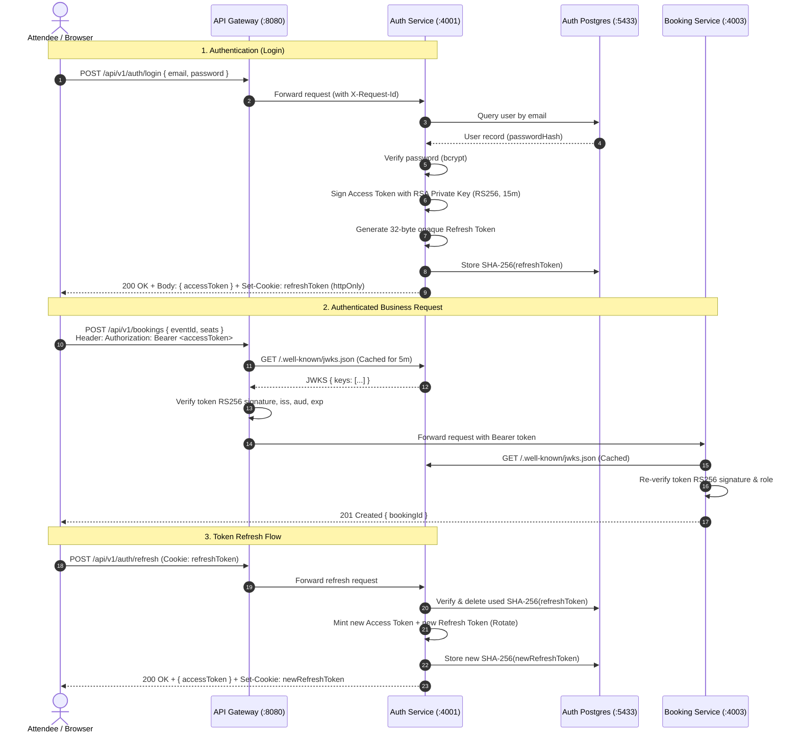

# Architecture & Migration: Asymmetric RS256 Authentication & JWKS

## Overview

This document details the architectural migration of the **Ticksy Auth Service** from symmetric shared-secret authentication (HS256) to **asymmetric public/private key authentication (RS256)** using a **JSON Web Key Set (JWKS)** endpoint, along with cryptographically secure **opaque refresh tokens**.

---

## 1. Problem Statement: Why Change from Symmetric to Asymmetric?

### The Previous Architecture: Symmetric HS256 (`JWT_ACCESS_SECRET`)

In the initial implementation, access tokens were signed and verified using **HS256 (HMAC with SHA-256)**:
- **Shared Secret:** Signing and verification both required the exact same secret string (`JWT_ACCESS_SECRET`).
- **The Security Flaw in Microservices:**
  - Ticksy is a polyglot microservices system composed of multiple independent services:
    - **Gateway** (Node/TypeScript)
    - **Catalog** (Python/FastAPI)
    - **Booking** (Java/Spring Boot)
    - **Payment** (C#/.NET)
    - **Ledger** (C#/.NET)
  - Every downstream service must independently authenticate and authorize incoming requests (as mandated by AGENTS.md §6.6 — defense-in-depth, never relying solely on the gateway).
  - To verify an HS256 token, **every single downstream service needed the secret signing key**.
  - **Forging Risk:** If *any* downstream service, container, or environment variable was compromised, an attacker possessing `JWT_ACCESS_SECRET` could forge legitimate-looking tokens for **any user, any role (including ADMIN)**, and access the entire platform without Auth service knowledge.
  - **Operational Fragility:** Key rotation required coordinating simultaneous redeployment of every service across 5 different programming languages.

```
[ PREVIOUS FLAWED MODEL: SYMMETRIC HS256 ]

                  +------------------------+
                  |      Auth Service      |
                  | Signs with: SECRET_KEY |
                  +-----------+------------+
                              |
       +----------------------+----------------------+
       |                      |                      |
       v                      v                      v
+--------------+       +--------------+       +--------------+
|   Gateway    |       |   Catalog    |       |   Booking    |
| Verifies with|       | Verifies with|       | Verifies with|
|  SECRET_KEY  |       |  SECRET_KEY  |       |  SECRET_KEY  |
+--------------+       +--------------+       +--------------+
       ^                      ^                      ^
       |                      |                      |
[ DANGER: Any service holding SECRET_KEY can FORGE arbitrary tokens! ]
```

---

### The New Architecture: Asymmetric RS256 (`RSA-2048` + JWKS)

Under **RS256 (RSA Signature with SHA-256)**:
1. **Private Key (Signing):**
   - Held **exclusively** by the Auth Service.
   - Kept in local filesystem (`keys/private.pem`), git-ignored, or loaded via secure secret managers.
   - Never shared with any other service, database, or network request.
2. **Public Key (Verification):**
   - Derived mathematically from the private key (`keys/public.pem`).
   - Exposed publicly by Auth service at the root endpoint:
     ```http
     GET /.well-known/jwks.json
     ```
   - Downstream services download and cache the public key via JWKS.
3. **Cryptographic Guarantee:**
   - Downstream services can mathematically verify that a token was signed by Auth's private key.
   - Even if a downstream service is completely breached, an attacker **cannot forge tokens** because the public key can only verify signatures, never create them.

```
[ NEW SECURE MODEL: ASYMMETRIC RS256 + JWKS ]

                  +------------------------+
                  |      Auth Service      |
                  | Signs with: PRIVATE KEY|
                  +-----------+------------+
                              |
                  Exposes: GET /.well-known/jwks.json (PUBLIC KEY)
                              |
       +----------------------+----------------------+
       | (fetches public key) | (fetches public key) | (fetches public key)
       v                      v                      v
+--------------+       +--------------+       +--------------+
|   Gateway    |       |   Catalog    |       |   Booking    |
| Verifies with|       | Verifies with|       | Verifies with|
|  PUBLIC KEY  |       |  PUBLIC KEY  |       |  PUBLIC KEY  |
+--------------+       +--------------+       +--------------+
       |                      |                      |
[ SAFE: Zero forge capability! Public key can only VERIFY, never SIGN ]
```

---

## 2. Refresh Token Overhaul: Opaque Cryptographic Tokens

### The Previous Vulnerability
Previously, refresh tokens were themselves JWTs signed with a shared secret (`JWT_REFRESH_SECRET`). If an access token or secret was captured, managing state and revocation was cumbersome.

### The New Pattern
- **Format:** 32-byte cryptographically random string encoded as `base64url` (`crypto.randomBytes(32).toString('base64url')`).
- **Storage:** Only the **SHA-256 hash** of the refresh token is stored in PostgreSQL (`RefreshToken.tokenHash`), never the raw token.
- **Delivery:** Delivered exclusively as an `httpOnly`, `SameSite=Strict`, `Path=/api/v1/auth`, `Secure` cookie named `refreshToken`.
- **Rotation:** Each call to `POST /api/v1/auth/refresh` immediately deletes the used token and issues a new pair (Access Token + new Refresh Token).
- **Breach Detection:** If an already-consumed or invalid refresh token is used (indicating token theft/replay), the Auth service revokes **all** active sessions for that user family.

---

## 3. How RS256 & JWKS Work (Deep Dive)

### 3.1 Token Signing & Structure

When a user signs in (`POST /api/v1/auth/login`) or registers (`POST /api/v1/auth/register`):
1. Auth service loads the PKCS#8 RSA private key (`keys/private.pem`) using `jose.importPKCS8()`.
2. Auth constructs the standard JWT claims matching AGENTS.md §6.3:
   ```json
   {
     "sub": "b2f63d08-a128-4448-8dfb-b0b925b412a8",
     "email": "user@example.com",
     "name": "Jane Doe",
     "role": "ATTENDEE",
     "iss": "ticksy-auth",
     "aud": "ticksy-api",
     "iat": 1729147200,
     "exp": 1729148100
   }
   ```
3. Auth attaches the token header containing the algorithm and key identifier:
   ```json
   {
     "alg": "RS256",
     "typ": "JWT",
     "kid": "ticksy-auth-key-1"
   }
   ```
4. Signs the payload using `new SignJWT(...).sign(privateKey)`. TTL is set to **15 minutes**.

### 3.2 The JWKS Endpoint (`GET /.well-known/jwks.json`)

The JWKS endpoint is served at root level (not under `/api/v1`):
```http
GET /.well-known/jwks.json HTTP/1.1
Host: auth:4001
```

**Response:**
```http
HTTP/1.1 200 OK
Content-Type: application/json
Cache-Control: public, max-age=300

{
  "keys": [
    {
      "kty": "RSA",
      "n": "u1wA3z4y... [Base64URL modulus] ...",
      "e": "AQAB",
      "kid": "ticksy-auth-key-1",
      "use": "sig",
      "alg": "RS256"
    }
  ]
}
```

- `kty`: Key Type (`RSA`).
- `n`: Modulus (part of public key).
- `e`: Exponent (`AQAB` = 65537).
- `kid`: Key ID matching the token header.
- `use`: Intended use (`sig` = signature verification).
- `alg`: Algorithm (`RS256`).
- `Cache-Control: public, max-age=300`: Allows downstream services and gateways to cache public keys for 5 minutes, eliminating network overhead on every API call.

---

## 4. End-to-End Authentication Sequence



---

## 5. Summary of Code Changes in `services/auth`

| File | Change Details |
|---|---|
| `src/config/env.ts` | Removed `JWT_ACCESS_SECRET`, `JWT_REFRESH_SECRET`. Added `JWT_PRIVATE_KEY_PATH`, `JWT_PUBLIC_KEY_PATH`, `JWT_KEY_ID`, `JWT_ISSUER`, `JWT_AUDIENCE`, `LOG_LEVEL`. |
| `src/config/logger.ts` | Introduced singleton `pino` logger for structured JSON logs to `stdout` with `requestId` and `service: "auth"`. |
| `src/utils/jwt.ts` | Complete rewrite using `jose`. Asynchronous `signAccessToken()`, `verifyAccessToken()` with `algorithms: ['RS256']`, and `getJwks()`. |
| `src/utils/hashToken.ts` | Added `generateOpaqueToken()` (32-byte crypto random base64url string) and `hashToken()` (SHA-256). |
| `src/utils/AppError.ts` | Added standard `code` property (`UPPER_SNAKE_CASE`) with HTTP defaults. |
| `src/types/jwt.types.ts` | Updated `AccessTokenPayload` to include `name: string`. Removed old `RefreshTokenPayload`. |
| `src/middlewares/auth.middleware.ts` | Converted to `async` middleware using `verifyAccessToken()`. Rejects invalid tokens with `401 UNAUTHENTICATED`. |
| `src/middlewares/error.middleware.ts` | Enforced uniform JSON error envelope `{ success: false, code, message, requestId, details? }`. |
| `src/middlewares/validate.middleware.ts` | Formatted validation errors into standard `VALIDATION_ERROR` (HTTP 400) with field detail list. |
| `src/middlewares/requestId.middleware.ts` | Reads or generates `X-Request-Id` UUID v4 and echoes it in response header and logger context. |
| `src/services/auth.service.ts` | Implemented opaque token generation & rotation, constant-time dummy password hashing on missing user, standard error codes (`EMAIL_TAKEN`, `INVALID_CREDENTIALS`). |
| `src/routes/jwks.routes.ts` | Added `GET /.well-known/jwks.json` with `Cache-Control: public, max-age=300`. |
| `src/app.ts` | Integrated request ID middleware, `pino-http` logging, live/ready probes, and mounted JWKS route. |
| `src/tests/jwt.test.ts` | Unit tests covering valid issuance/verification, expiration rejection, issuer/audience enforcement, key mismatch tampering rejection, and JWKS structure. |
| `Dockerfile` | Multi-stage Node 22 build, non-root user `nodejs`, pre-start `prisma migrate deploy`. |

---

## 6. How Downstream Services Consume Auth's JWKS

Every downstream service receives the environment variable:
```env
AUTH_JWKS_URL=http://auth:4001/.well-known/jwks.json
JWT_ISSUER=ticksy-auth
JWT_AUDIENCE=ticksy-api
```

### 6.1 Node.js / TypeScript (Gateway)
Using `jose`:
```typescript
import { createRemoteJWKSet, jwtVerify } from 'jose';

const JWKS = createRemoteJWKSet(new URL(process.env.AUTH_JWKS_URL!));

export async function verifyToken(token: string) {
  const { payload } = await jwtVerify(token, JWKS, {
    issuer: process.env.JWT_ISSUER,
    audience: process.env.JWT_AUDIENCE,
    algorithms: ['RS256']
  });
  return payload;
}
```

### 6.2 Python / FastAPI (Catalog)
Using `PyJWT` with `PyJWKClient`:
```python
import jwt
from jwt import PyJWKClient
import os

jwks_client = PyJWKClient(os.getenv("AUTH_JWKS_URL"))

def verify_token(token: str):
    signing_key = jwks_client.get_signing_key_from_jwt(token)
    return jwt.decode(
        token,
        signing_key.key,
        algorithms=["RS256"],
        issuer=os.getenv("JWT_ISSUER"),
        audience=os.getenv("JWT_AUDIENCE")
    )
```

### 6.3 Java / Spring Boot (Booking)
Spring Security OAuth2 Resource Server automatically discovers and caches JWKS:
```yaml
spring:
  security:
    oauth2:
      resourceserver:
        jwt:
          jwk-set-uri: ${AUTH_JWKS_URL}
          issuer-uri: ${JWT_ISSUER}
```

---

## 7. Operational Runbook: Generating Keys & Zero-Downtime Rotation

### 7.1 Local / Development Key Generation
Generate the 2048-bit RSA key pair:
```bash
mkdir -p keys
openssl genrsa -out keys/private.pem 2048
openssl rsa -in keys/private.pem -pubout -out keys/public.pem
chmod 600 keys/private.pem
```

### 7.2 Zero-Downtime Key Rotation Procedure
When rotating RSA keys in production:
1. Generate a new key pair: `keys/private-v2.pem` and `keys/public-v2.pem`.
2. Update the Auth Service JWKS endpoint to expose **both** keys (Key 1 with `kid="ticksy-auth-key-1"` and Key 2 with `kid="ticksy-auth-key-2"`).
3. Update Auth to sign new tokens using Key 2 (`JWT_KEY_ID="ticksy-auth-key-2"`).
4. Downstream services will automatically fetch Key 2 from the JWKS upon receiving tokens with the new `kid`.
5. Because access token TTL is strictly 15 minutes, wait **16 minutes** for all tokens signed with Key 1 to expire.
6. Remove Key 1 from the JWKS endpoint. Rotation is complete with zero client downtime.
